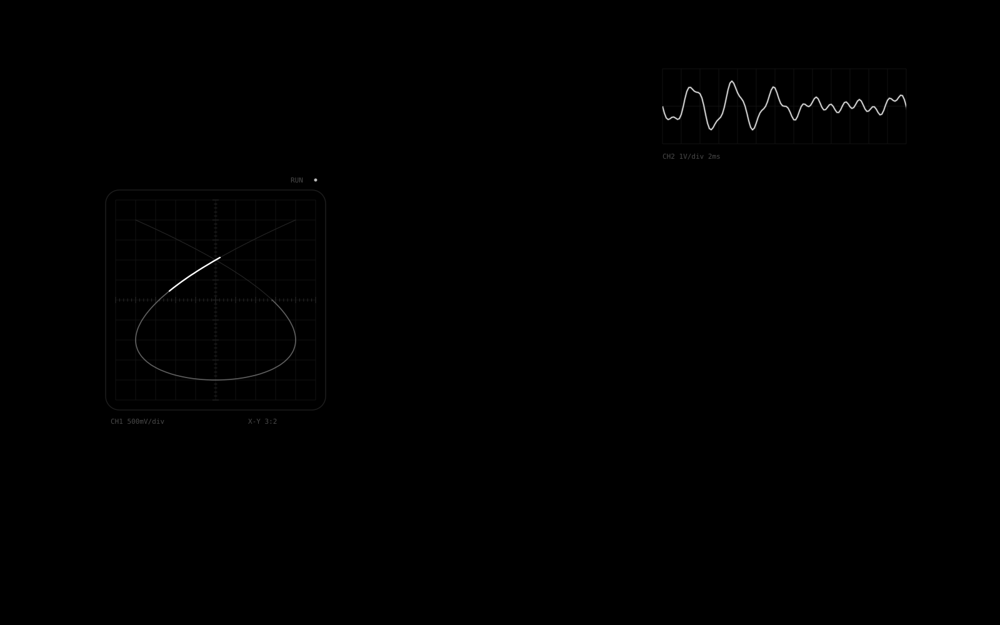
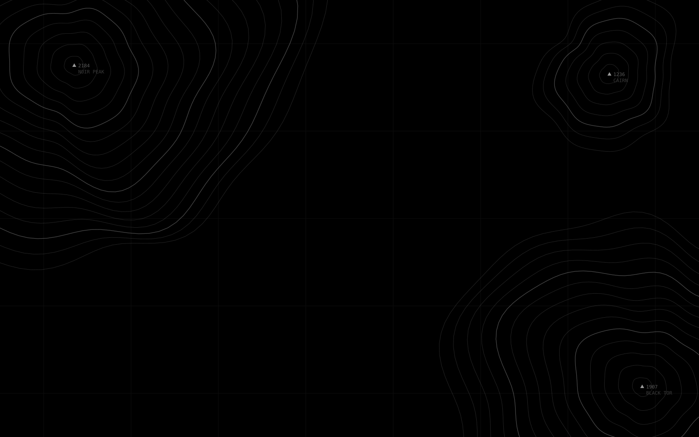
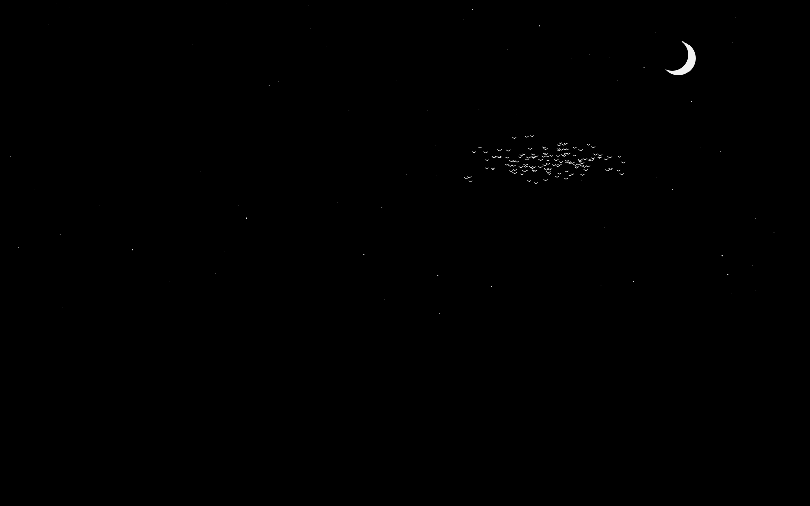

<p align="center">
  
</p>

<p align="center">
  <b>True-black, black-and-white themes for the Claude desktop app, made for OLED screens.</b><br>
  Slow animated scenes in the margins, see-through glass, and every pixel you don't need switched off.
</p>

<p align="center">
  
  
  
  
</p>

<p align="center">
  <a href="#the-looks">The looks</a> ·
  <a href="#install">Install</a> ·
  <a href="#use">Use</a> ·
  <a href="#make-it-yours">Make it yours</a> ·
  <a href="#why-oled">Why OLED</a> ·
  <a href="#faq">FAQ</a>
</p>

<br>

## The looks

Every look is a pure black page with one slow scene in white light, kept to the edges of the window so the words stay in the clear. The previews below are the scenes themselves, moving as they do in the app.

<table>
  <tr>
    <td width="50%" valign="top">
      <br>
      <b>Eclipse</b><br>
      <sub>A black sun in a slowly turning white corona. Now and then a diamond-ring glint flares on its rim.</sub>
    </td>
    <td width="50%" valign="top">
      <br>
      <b>Deep Field</b> · <sub>with sound</sub><br>
      <sub>Stars drifting at two depths, a spiral galaxy turning in the corner, and the odd shooting star.</sub>
    </td>
  </tr>
  <tr>
    <td width="50%" valign="top">
      <br>
      <b>Oscilloscope</b><br>
      <sub>A phosphor X-Y scope tracing a turning Lissajous knot, with a live waveform. Replies in mono type.</sub>
    </td>
    <td width="50%" valign="top">
      <br>
      <b>Night Rain</b> · <sub>with sound</sub><br>
      <sub>Rain falling down the margins, rings spreading in the puddles at the corners.</sub>
    </td>
  </tr>
  <tr>
    <td width="50%" valign="top">
      <br>
      <b>Topography</b><br>
      <sub>Contour lines of three hills on a map sheet, a slow ping running out from each summit.</sub>
    </td>
    <td width="50%" valign="top">
      <br>
      <b>Murmuration</b><br>
      <sub>A flock of 130 starlings folding and stretching under a thin crescent moon.</sub>
    </td>
  </tr>
  <tr>
    <td width="50%" valign="top">
      <br>
      <b>Starfield</b> · <sub>with sound</sub><br>
      <sub>Only stars, drifting at two depths, and now and then a star falls.</sub>
    </td>
    <td width="50%" valign="top">
      <br>
      <b>Full Moon</b><br>
      <sub>A full moon in the corner, its seas soft gray, a halo breathing round it and thin clouds drifting past.</sub>
    </td>
  </tr>
  <tr>
    <td colspan="2" align="center">
      <b>Void</b><br>
      <sub>No scene at all. Every pixel off but the words: the least power, and no motion.</sub>
    </td>
  </tr>
</table>

## Install

OLED Noir is a Claude Code mod. It draws in the **Claude desktop app** (and the mobile app); the terminal and editors don't draw themes.

**In the desktop app:** click **+** next to the prompt box, then **Plugins** → **Add marketplace**, enter `Draganoider/oled-noir`, then **Add plugin**.

**At the prompt of a Claude Code terminal session:**

```
/plugin install oled-noir --marketplace Draganoider/oled-noir
```

Answer `y` to add the marketplace, then press Enter to install it for your user, so it loads in every session.

**From a shell:**

```
claude plugin install oled-noir --marketplace Draganoider/oled-noir
```

New sessions start with it straight away. In a session that was already open, run `/reload-plugins`, then send a message: a new session draws its theme once the first message is sent.

> [!NOTE]
> A session shows one theme at a time. If you use another theme mod, such as Anthropic's `theme-examples`, turn its theme off first (`/custom-theme off`), or the two take turns.

## Use

Type **`/noir`** and a card opens above the prompt: every look with a **Try** button, and a row of buttons for each setting below. Try as many as you like, then **Close**.

| Command | What it does |
| --- | --- |
| `/noir` | Opens the card |
| `/noir <look>` | Puts a look on, for example `/noir night rain` |
| `/noir next` | Steps to the next look |
| `/noir list` | Names every look and setting |
| `/noir off` | Turns OLED Noir off (`/noir` brings it back) |
| `/noir glass` · `text` · `bubble` · `tools` | Lists that setting's choices. Add a name to pick one, or `next` to step through them |

Your choices are kept for every session and every project.

## Make it yours

A fresh install starts on **Starfield**, with **bare** glass, **smoky** text, **outline** bubbles and **pill** tool rows. Each part can be changed on its own.

<details open>
<summary><b>Panels</b> · <code>/noir glass</code> · the glass the app lays over the scene behind the chat</summary>

| Kind | Looks like |
| --- | --- |
| `none` | No glass at all: the app draws its panels its own way |
| `bare` ✦ | Almost no glass: the scene shows sharp behind the chat |
| `clear` | A thin black film, the scene still crisp |
| `light` | A light tint with a touch of blur |
| `mist` | Half see-through, the scene softened |
| `frosted` | Dark frosted glass, the scene faint |
| `haze` | Heavy blur with a medium tint: the scene becomes a soft glow |
| `graphite` | Dark gray glass, so the chat stands apart from the black page |
| `smoke` | Nearly black, only the brightest light shows through |
| `solid` | Black, nothing shows through |

</details>

<details open>
<summary><b>Text</b> · <code>/noir text</code> · what sits behind the words of each reply</summary>

| Kind | Looks like |
| --- | --- |
| `black` | A solid black box: hides the scene behind the words completely |
| `soft` | Nearly black with soft, smoky edges instead of a hard box |
| `smoky` ✦ | A dark see-through patch that fades out at the edges |
| `dim` | A light darkening: the scene shows faintly through the words |
| `halo` | Almost no fill, but a dark glow around the text keeps it readable |
| `none` | Nothing at all: the words sit right on the scene |

</details>

<details open>
<summary><b>You</b> · <code>/noir bubble</code> · how your own messages look</summary>

| Kind | Looks like |
| --- | --- |
| `outline` ✦ | A black bubble with a thin gray outline |
| `ring` | A black pill with a bright white outline |
| `soft` | Nearly black with smoky, fading edges |
| `glass` | A faint white tint with a light edge, like frosted glass |
| `inverted` | A white bubble with black words, so your messages stand out |
| `none` | No bubble: your words sit right on the scene |

</details>

<details open>
<summary><b>Tools</b> · <code>/noir tools</code> · the rows that show Claude's tool calls</summary>

| Kind | Looks like |
| --- | --- |
| `card` | A near-black card with a faint edge and code type |
| `outline` | Black with a clearer gray outline |
| `terminal` | Black with a thin white frame and bright code type |
| `pill` ✦ | A rounded dark pill in plain type |
| `soft` | Nearly black with smoky, fading edges |
| `quiet` | Dim gray code type on black, no frame: barely there |
| `none` | The app's own tool rows |

</details>

<sub>✦ the default</sub>

## Why OLED

On an OLED screen a black pixel is switched off: it draws no power and gives no light. OLED Noir is built around that.

- **True black.** The page is `#000000`, and panels sit only a hair above it.
- **Soft white.** Text is `#f2f2f2`, not pure white, which blooms on OLED.
- **Light at the edges.** Each scene keeps its subject in the margins, away from the words and the prompt.
- **Nothing bright stands still.** Every scene drifts, turns or falls, slowly, so no bright shape sits on one spot of the panel for hours.
- **Void** turns off everything but the words, for the least power of all.
- **Black and white, with meaning kept.** Red, green and amber stay faintly tinted, so an error or a success still reads at a glance.

## Sound

**Deep Field**, **Starfield** and **Night Rain** have quiet ambient sound and short cues for a message sent, a turn finished and an error. Sound stays off until you press the speaker in the session's title bar; the menu beside it sets the volume or keeps only the cues. It is made by the app from numbers, not recordings, so the mod ships no audio files.

## Comfort and accessibility

- With **reduced motion** turned on in your system, every scene rests as a finished still picture.
- Motion is slow by design: nothing flashes, and every change of light takes seconds.
- Your accessibility settings in the app (fonts, higher contrast) always win over the theme.

## FAQ

<details>
<summary><b>Can it change the sidebar, the session rail or the box I type in?</b></summary>

No. The app draws those itself, and a theme reaches them only through its color palette, which OLED Noir already sets to true black. The glass setting covers the chat column, the part the app lets a theme see through.
</details>

<details>
<summary><b>Why is there a dark box behind code?</b></summary>

Code blocks, permission prompts and questions keep the app's own look; no theme can restyle them.
</details>

<details>
<summary><b>Nothing changed after I installed it.</b></summary>

Send a message in the session: a new session draws its theme once the first message is sent. In a session that was open before you installed, run `/reload-plugins` first. If another theme mod is on, turn it off.
</details>

<details>
<summary><b>How do I remove it?</b></summary>

`/noir off` turns the look off. To uninstall, open **+** → **Plugins** in the desktop app, or run `claude plugin uninstall oled-noir@oled-noir`.
</details>

## Privacy

OLED Noir sends nothing anywhere and reads none of your messages. It stores five words on your computer, through Claude Code: the look, glass, text, bubble and tool row you chose.

## Develop

```
oled-noir/
├── .claude-plugin/
│   ├── plugin.json        the mod's manifest
│   ├── marketplace.json   makes this repository installable
│   └── icon.png
├── hooks/
│   ├── register.tsx       /noir, the card, and setting the theme
│   ├── variants.ts        the looks and every setting's choices
│   ├── scenes.ts          the animated scenes, as SVG built from code
│   ├── make-colors.js     the color palette builder from Claude Code's plugin kit
│   └── noir.test.tsx      tests
├── types/index.d.ts       the mod's state contract
├── scripts/build-previews.mjs
└── assets/                the banner and the scene previews above
```

- **Try your changes:** start Claude Code with `claude --plugin-dir <this folder>`, or install from a local clone with `claude plugin marketplace add <this folder>`, then `/reload-plugins` after each edit.
- **Check them:** `claude plugin validate .` and `claude plugin test .`
- **Rebuild the previews** after changing a scene: `node scripts/build-previews.mjs` (Node 23.6 or newer).

See [CONTRIBUTING.md](CONTRIBUTING.md) for adding a look of your own.

## License

[MIT](LICENSE) © 2026 Draganoider.

`hooks/make-colors.js` and `hooks/make-colors.d.ts` are generated by Claude Code's plugin authoring kit, which tells mods to include them unchanged. OLED Noir is a community mod and is not affiliated with or endorsed by Anthropic. Claude is a trademark of Anthropic.
